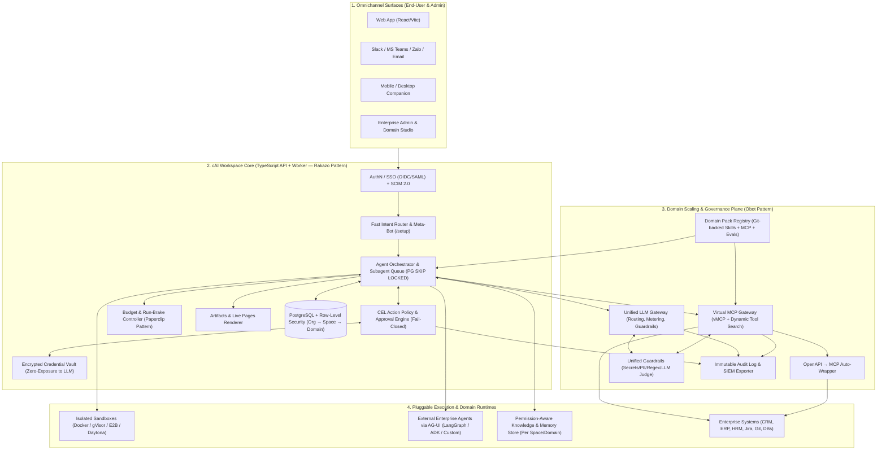

# 03 — Recommended Reference Architecture for cAI

> [!abstract] Tóm tắt nhanh (TL;DR)
> Để đáp ứng đồng thời cả 3 mục tiêu của **cAI** (**B2B Enterprise Sellable** + **End-user tạo Agent linh hoạt không kéo-thả** + **Scale mạnh cho `n` domain**) với **IP sạch 100%**, kiến trúc tối ưu nhất là mô hình **3-Layer Hybrid Composable Platform**:
> 1. **Experience & Workspace Core (Lấy cảm hứng / Fork từ `Rakazo` — Apache-2.0):** Chat-first, Multi-tenant Organization/Space (PostgreSQL RLS), Conversational Agent Builder, Routines, Skills, Pages, Approvals, Multi-surface (Web/Slack/Teams/Mobile).
> 2. **Domain Scaling & Governance Plane (Tích hợp trực tiếp hoặc xây theo `Obot` — MIT):** Virtual MCP Gateway (vMCP) + Dynamic Tool Search + OpenAPI-to-MCP + LLM Gateway + Unified Guardrails + Git-backed Domain Catalog.
> 3. **Enterprise Control, Eval & Multi-Agent Layer (Học từ `Paperclip` + `CopilotKit OpenBot`):** CEL Action Policy Engine, Budget Brakes, Skill Eval Kernel, AG-UI External Agent Protocol, Portable Domain Packs (`domain.md` / YAML).

---

## 1. Sơ Đồ Kiến Trúc Tổng Thể (cAI Reference Architecture)

---

## 2. Giải Pháp Chi Tiết Cho Từng Tiêu Chí Của cAI

### Tiêu chí 1: Làm cho Doanh nghiệp & Bán được B2B (Enterprise-Ready)

| Yêu cầu B2B | Cơ chế kiến trúc đề xuất cho cAI | Nguồn tham chiếu |
| :--- | :--- | :--- |
| **Multi-tenancy & Cô lập dữ liệu** | Phân cấp `Organization` → `Space (Department/Team)` → `Bot`. Cô lập cứng ở tầng DB bằng **PostgreSQL Row-Level Security (RLS)** + khóa mã hóa riêng theo Space (`SpaceKey`). | Rakazo (`rakazo_app` RLS) |
| **Identity & Access (IAM)** | SSO (OIDC/SAML 2.0), **SCIM 2.0** đồng bộ user/group từ Okta/Entra ID. RBAC 3 cấp: Org Admin, Domain Owner, Member. Tách bạch **Shared App** (tài khoản công ty do Admin cấp) và **Personal App** (OAuth cá nhân). | Rakazo + Obot + OpenBot |
| **Governance & Safety** | **CEL Action Policy Engine** (deny-before-allow, fail-closed, `dry-run` mode) + **Unified Guardrails** lọc PII/Secrets trên cả LLM và MCP traffic + **Approval Cards** cho mọi hành động ghi/gửi/xóa/chi tiền. | OpenBot + Obot |
| **Kiểm toán (Compliance Audit)** | Ghi đầy đủ `actor_id`, `bot_id`, **`initiator_kind`** (`person` vs `routine` vs `handoff` — lọc được ngay *"Nobody watching"*), xuất CSV chống formula-injection + **SIEM Forwarding**. | OpenBot + Rakazo |
| **Kiểm soát chi phí (FinOps)** | **Budget Policies + Automatic Run Brakes** theo Org / Department / Agent + Model Credit Ledger + Code Filter trước trigger để không đốt token vào event rác. | Paperclip + Rakazo + Kortix |
| **Mô hình bán & triển khai** | Hỗ trợ đồng thời **3 mode bán B2B** trên cùng 1 codebase: 1. **Multi-tenant Cloud SaaS** (SME/Mid-market) 2. **Dedicated VPC / Connected Self-Hosted** (Outbound Connector ký Ed25519 + Offline Entitlement Key — học Mausbot) 3. **Air-gapped On-Premise** (Helm Chart Kubernetes + Local LLM). | Mausbot (`self-hosted-design.md`) + Obot (Helm) |
| **Bản quyền sạch (IP Clean)** | Chỉ sử dụng dependency / base có license **Apache-2.0 hoặc MIT**. Tuyệt đối loại bỏ mọi thành phần PolyForm, Elastic 2.0, Dify Modified Apache, OpenMausBot `enterprise/`, CopilotKit Intelligence. | License Audit (`01`) |

---

### Tiêu chí 2: Người dùng cuối tự tạo Agent — Hạn chế kéo-thả nhưng vẫn Linh hoạt (Flexible)

> [!important] Tại sao KHÔNG nên làm Drag-and-Drop Workflow (kiểu n8n/Dify/Flowise)?
> - Người dùng cuối (Sales, HR, Finance, Ops, CSKH) **không biết vẽ đồ thị điều kiện, xử lý vòng lặp, bắt lỗi JSON hay nối biến giữa các node**.
> - Workflow kéo-thả giòn (brittle): chỉ cần input lệch format là gãy cả flow.
> - Ngược lại, nếu chỉ cho 1 ô "System Prompt" trống trơn thì người dùng cũng không biết viết và Agent thiếu cấu trúc kiểm soát.

**Giải pháp "Structured Conversational Builder" (5 tầng linh hoạt, 0 kéo-thả):**

1. **Tầng 1 — Tạo Agent bằng Hội thoại (`/setup` — Meta-Bot):**
   - Người dùng bấm **+ New Agent** và chỉ cần nói: *"Tạo cho tôi trợ lý đối chiếu công nợ mỗi sáng thứ Hai từ file Excel trên Google Drive và gửi báo cáo lên Slack #finance"*.
   - **Builder Meta-Bot** (học Mausbot `/setup` + Rakazo Fleet) hỏi thêm 2–3 câu làm rõ, tự sinh ra **Agent Card có cấu trúc** gồm đúng **6 thành phần rõ nghĩa** (rút gọn từ 8 Primitives của OpenBot):
     - **Role & Standing Rules** (Vai trò + mục tiêu + giới hạn không được làm)
     - **Knowledge** (Tài liệu / Space Memory / Nguồn RAG)
     - **Skills** (Playbook cách làm việc, gọi bằng `/skill` hoặc tự kích hoạt)
     - **Tools / Apps** (Chọn bật/tắt các App hoặc vMCP mà Admin đã duyệt)
     - **Triggers / Routines** (Khai báo dạng câu tiếng tự nhiên: *"Mỗi thứ Hai 9h"*, *"Khi có email mới chứa hóa đơn"*, *"Khi có webhook từ CRM"*)
     - **Guardrails & Approvals** (Chọn 1 trong 3 mức: *Luôn hỏi trước khi gửi/sửa* · *Tự duyệt theo rule* · *Chỉ đọc & báo cáo*).
2. **Tầng 2 — Dạy Agent bằng ví dụ (Teach-by-Demo → Skill):**
   - Người dùng làm mẫu 1 lần trong chat hoặc trên browser sandbox, bấm **"Lưu thành Skill"** → hệ thống tự tổng hợp thành file `SKILL.md` có version để tái sử dụng ổn định mà không cần vẽ flowchart (học OpenBot Teach-a-Bot + OpenClaw `SKILL.md`).
3. **Tầng 3 — Linh hoạt có kiểm soát cho Power User (Progressive Disclosure):**
   - Mặc định ẩn hết kỹ thuật (**Simple Mode** — học Mausbot `DESIGN.md`).
   - Khi Domain Owner cần quy trình chặt chẽ hơn (VD: bắt buộc kiểm tra 3 bước trước khi duyệt đơn), họ dùng **Checklist / Structured Playbook (Markdown có bước bắt buộc + Approval Gate)** hoặc **Skill Studio + Saved Test Cases** (học Paperclip) để chạy thử và chốt phiên bản.
4. **Tầng 4 — Phối hợp đa Agent tự nhiên (Group Chat & Typed Handoff):**
   - Thay vì nối dây giữa 2 agent bằng drag-and-drop, người dùng chỉ cần đưa Agent Sales + Agent Legal + Agent Finance vào chung 1 Channel/Group và `@mention` hoặc bật **Auto-Routing** (Fast Intent Router).
   - Ở dưới tầng máy, giao tiếp giữa các Agent được chuẩn hóa bằng **Typed Handoff Schema** (task, constraints, done criteria, max depth).
5. **Tầng 5 — Đầu ra trực quan (`Pages` / Interactive Components):**
   - Thay vì chỉ trả lời tường chữ dài, Agent tạo được **Live Dashboard / Bảng duyệt / Document** (`page-kit` của Rakazo) cho người dùng tương tác trực tiếp.

---

### Tiêu chí 3: Khả năng Scale Mạnh Cho `n` Domain (HR, Finance, Legal, Sales, IT, Supply Chain, Healthcare...)

Muốn scale từ 1 domain lên `n` domain mà **không phải fork code cho từng ngành** và **không làm LLM bị ngáo vì quá nhiều tool**, kiến trúc **cAI** cần **5 trụ cột Domain-Scaling**:

1. **Domain Pack as Code (Đóng gói 1 Domain thành 1 Bundle di động):**
   - Mỗi Domain (VD: `domain-finance-ap`, `domain-hr-recruiting`, `domain-legal-contract`, `domain-it-helpdesk`) được đóng gói thành một **Domain Pack** (YAML + `SKILL.md` + `agents.yaml` + vMCP spec + Eval golden test set + Approval policy mặc định — kết hợp `team.md` của Mausbot + Git Catalog của Obot + `teams-catalog` của Paperclip).
   - Cài đặt một domain mới cho khách hàng = **1 click import Domain Pack** (tự động strip secret, hỏi OAuth các app cần thiết, routine mặc định ở trạng thái paused chờ kích hoạt).
2. **Virtual MCP Gateway (vMCP) + Dynamic Tool Search (Giải quyết bài toán `N` Tools):**
   - Khi hệ thống phục vụ `n` domain (mỗi domain 20–50 API/tools → tổng 1.000+ tools), **tuyệt đối không nhồi toàn bộ tool schema vào context của Agent**.
   - Mỗi Domain gắn với một **vMCP profile** riêng (chỉ nhìn thấy tool thuộc domain đó theo RBAC) + bật **Tool Search** (học Obot) để Agent tự tìm & load đúng 3–5 tool cần dùng cho từng lượt xử lý.
3. **OpenAPI → MCP Auto-Wrapping (Tích hợp cực nhanh vào hệ thống cũ của từng ngành):**
   - Doanh nghiệp ở mỗi domain đều có phần mềm đặc thù (SAP, MISA, Bravo, Base, Lark, Odoo, HIS bệnh viện, core banking...).
   - Chỉ cần upload file **OpenAPI / Swagger spec** + cấu hình Auth/Egress → nền tảng tự sinh Hosted MCP Server kèm policy chặn/duyệt từng endpoint (học Obot).
4. **Bring Your Own Agent via AG-UI (Không bị giới hạn vào 1 engine duy nhất):**
   - 80% tác vụ doanh nghiệp chạy bằng Built-in Agent của cAI.
   - 20% tác vụ domain siêu đặc thù (VD: mô hình tính rủi ro tín dụng, tối ưu tuyến logistics, chẩn đoán kỹ thuật viết bằng Python/LangGraph/Google ADK) được cắm trực tiếp vào cAI thông qua **AG-UI Protocol** (học CopilotKit OpenBot) — dùng chung UI chat, RBAC, Audit và Approval của cAI!
5. **Domain Eval & Active Learning Loop (Đảm bảo chất lượng khi scale `n` domain):**
   - Mỗi Domain Pack đi kèm bộ **Golden Eval Set** (học `paperclip-eval-kernel`). Khi nâng cấp LLM model hoặc sửa Skill, hệ thống tự chạy eval regression trước khi publish lên toàn bộ tenant thuộc domain đó.

---

## 3. So Sánh 3 Chiến Lược Triển Khai (Build vs. Fork Decision Matrix)

| Tiêu chí | Phương án A: Fork `Rakazo` làm Base + Ghép `Obot` làm MCP/LLM Plane *(Khuyên dùng)* | Phương án B: Fork `Paperclip` làm Control Plane + Xây lại Chat UX | Phương án C: Build Clean-Room từ đầu (lấy kiến trúc tham khảo) |
| :--- | :--- | :--- | :--- |
| **Tốc độ ra MVP bán B2B** | ⚡ **Nhanh nhất (6–10 tuần)** — Có sẵn Web/Desktop/Mobile, RLS, SCIM, Vault, Sandbox, Routines, Pages, Fleet | ⏱️ Trung bình (3–4 tháng) — Phải làm lại toàn bộ UX Chat/End-user & Sandbox Computer | 🐢 Chậm nhất (6–9 tháng) — Phải tự code lại auth, RLS, worker, sandbox, vault, UI |
| **Độ sạch License (B2B IP)** | ✅ **100% sạch** (Rakazo Apache-2.0 + Obot MIT) | ✅ **100% sạch** (MIT) | ✅ **100% sạch** |
| **Phù hợp End-user (No-Drag)** | 🏆 **Tốt nhất** — Triết lý chat-first & anti-workflow-builder khớp 100% | ⚠️ Khá — Hơi thiên về mindset Jira/Task Manager cho tech/ops | ✅ Tùy biến hoàn toàn |
| **Khả năng scale `n` domain** | 🏆 **Rất cao** nhờ ghép Obot (vMCP + Tool Search + OpenAPI→MCP + Guardrails) + Domain Pack format | ✅ Cao (nếu tự bổ sung vMCP & Sandbox layer) | ✅ Rất cao (tốn công build) |
| **Rủi ro kỹ thuật** | Cần làm quen codebase monorepo lớn của Rakazo + viết cầu nối giữa Rakazo API và Obot vMCP/LLM Gateway | Cần nhiều công sức UI/UX để người dùng phổ thông dễ dùng | Rủi ro chậm time-to-market & over-engineering |

> [!tip] Khuyến nghị thực chiến cho Kick-off cAI
> **Chọn Phương án A (Hybrid Fork `Rakazo` + Sidecar `Obot`):**
> - **Giai đoạn 1 (MVP — 4–6 tuần):** Dựng `Rakazo` (Apache-2.0) làm **cAI Core**, white-label giao diện, chuẩn hóa mô hình **Conversational `/setup`** + **Domain Pack format (`domain.md` / YAML)**, tạo trước **2–3 Domain Packs mẫu** (VD: Sales Ops, HR/Admin, Finance/Reporting) để đi pilot B2B ngay.
> - **Giai đoạn 2 (Domain Scaling — Tháng 2–3):** Gắn **`Obot` (MIT)** đứng làm **Enterprise MCP & LLM Gateway** (vMCP + Tool Search + OpenAPI→MCP + Guardrails + SIEM Audit) và bổ sung **CEL Action Policy** + **Budget Run Brakes** (học OpenBot & Paperclip).
> - **Giai đoạn 3 (Enterprise Expansion — Tháng 4–6):** Mở cổng **AG-UI Protocol** cho phép khách enterprise cắm custom domain agents, thêm **Skill Eval Studio** (học Paperclip), và đóng gói **Connected Self-Hosted / VPC Installer** (học Mausbot) để chốt deal Enterprise lớn.

---

## 4. Câu Hỏi Mở Cần Làm Rõ Ngay Sau Khi Có Brief Từ Claude Artifact

- [ ] **Phạm vi Domain ban đầu (Beachhead Domains):** cAI sẽ đánh vào 2–3 domain nào trước tiên (VD: Finance, HR, CSKH, Sales, Operations, Legal)?
- [ ] **Mức độ cần "Computer Use / Browser Sandbox":** Khách hàng B2B mục tiêu của cAI chủ yếu thao tác qua **API/MCP/Database** hay cần bot điều khiển **Trình duyệt/Desktop ảo** (nếu không cần Browser Sandbox ngay ở MVP thì hạ tầng nhẹ và rẻ hơn 5 lần)?
- [ ] **Mô hình triển khai ưu tiên:** Cloud SaaS Multi-tenant trước hay Dedicated VPC / On-Premise trước (liên quan thị trường Việt Nam / Đông Nam Á hay Global)?
- [ ] **Kênh giao tiếp chính của End-User:** Web App riêng của cAI là chính, hay phải nhúng sâu vào **Slack / Microsoft Teams / Zalo / Lark**?
- [ ] **Năng lực Tech Stack của team dev cAI:** Team mạnh **TypeScript (Node/React)** hay **Python + Go**? (Rakazo/Paperclip là TypeScript, Obot là Go, Onyx/Agent harnesses là Python).

---

## 5. Liên Kết Liên Quan
- Hub chủ đề: [[Hub - cAI]]
- Tổng quan & License Audit: [[01 - Open-Source Landscape & License Audit]]
- Giải phẫu mã nguồn: [[02 - Deep-Dive Codebase Analysis]]
