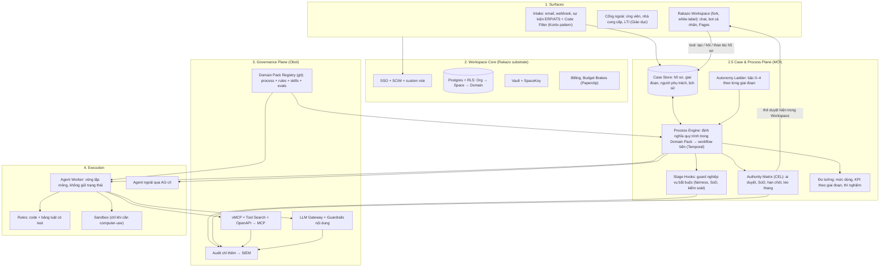

# 04 — Áp dụng Reference Architecture vào đề bài cAI

> [!abstract] Tóm tắt nhanh (TL;DR)
> Kiến trúc 3 lớp ở [[03 - Recommended Reference Architecture for cAI]] đúng hướng với quyết định "cAI là sản phẩm bán được". Nó giải tốt phần B2B (license sạch, RLS, SCIM, audit, budget) và phần scale `n` domain (Domain Pack, vMCP, Tool Search, OpenAPI → MCP).
>
> Khi đặt cạnh [[cAI - Product Brief (Claude Artifact)|brief gốc]], kiến trúc này còn **thiếu một lớp: Case & Process Plane**. Đây là lớp giữ hồ sơ đi qua các giai đoạn theo khung chuẩn, với cổng duyệt theo thẩm quyền, guard nghiệp vụ bắt buộc và SLA. Brief xoay quanh đúng lớp này: 3 cụm bàn giao nhau, HITL ở từng giai đoạn, "Định nghĩa xong" có eval.
>
> Áp dụng gồm bốn việc:
> 1. **Thêm Case & Process Plane.**
> 2. **Fork Rakazo nhưng chỉ dùng làm Experience & Workspace,** để lấy Org/Space, RLS, SCIM, Vault, Billing. Rakazo không làm lõi quy trình.
> 3. **Nâng Agent Card 6 thành phần thành 5 lớp có eval.**
> 4. **Thay "3 mức duyệt do người dùng chọn" bằng thang tự chủ do số liệu quyết định.**

---

## 1. Brief đòi gì mà 3 tiêu chí của Hub chưa nói

Ba tiêu chí trong [[Hub - cAI]] (B2B sellable, người dùng tự tạo agent không kéo-thả, scale `n` domain) là góc nhìn sản phẩm. Brief thêm bốn đòi hỏi về **chiều sâu nghiệp vụ**:

1. **Chuỗi giá trị có cấu trúc.** Mỗi phòng có 3 cụm theo khung chuẩn (APQC, CLM, phễu tuyển dụng, Bloom), cụm trước bàn giao cho cụm sau. Đơn vị công việc là **hồ sơ** (ứng viên, hoá đơn, hợp đồng, học sinh), không phải cuộc hội thoại.
2. **HITL ở đúng giai đoạn, đúng người.** JD, vùng xám, go/no-go, offer, giải ngân, báo cáo tài chính, redline. Agent không bao giờ tự làm các việc có hậu quả lớn.
3. **Guard xuyên suốt, chạy bắt buộc:** fairness, kiểm soát 100% giao dịch, bảo mật vụ việc, an toàn trẻ em trước mọi hội thoại.
4. **Nghiệm thu bằng số liệu:** eval đạt ngưỡng, staging với dữ liệu tổng hợp, mức dùng thật, và lớp đối chứng cho Giáo dục.

---

## 2. Đối chiếu yêu cầu brief với kiến trúc 03

| Yêu cầu trong brief                                           | Kiến trúc 03 đáp ứng bằng                                                     | Mức | Khoảng trống                                                                                                                                          |
| :------------------------------------------------------------ | :---------------------------------------------------------------------------- | :-: | :---------------------------------------------------------------------------------------------------------------------------------------------------- |
| 3 cụm theo khung, bàn giao giữa cụm                           | Group chat + `@mention` + Typed Handoff (OpenBot)                             | 🟡  | Typed handoff là điểm tốt. Nhưng group chat vẫn lấy hội thoại làm trung tâm; chưa có mô hình hồ sơ và giai đoạn                                       |
| Khung APQC / CLM / phễu / Bloom                               | Domain Pack (skills + agents + vMCP + eval + policy)                          | 🟡  | Pack chưa chứa **định nghĩa quy trình**. "Structured Playbook (Markdown có bước bắt buộc)" do LLM thực thi nên không ép buộc được                     |
| Cổng HITL bắt buộc, đúng người                                | Approval Cards + CEL Action Policy                                            | 🟡  | CEL viết được luật thẩm quyền, rất tốt. Còn thiếu: chuyển cho **một role cụ thể**, SoD, hạn chót, leo thang, uỷ quyền, gói bằng chứng cho người duyệt |
| Không tự hành động với việc có hậu quả lớn                    | CEL deny-before-allow + 3 mức duyệt do người dùng chọn                        | 🔴  | Người dùng chọn "Tự duyệt theo rule" cho lệnh chi là vi phạm brief. Mức người dùng chọn phải bị **chặn trần bởi policy của tổ chức**                  |
| Guard nội dung (an toàn trẻ em, PII, secret, chèn lệnh)       | Unified Guardrails trên LLM + MCP gateway (Obot)                              | 🟢  | Đặt ở gateway nên agent không đi vòng được. Đúng chỗ                                                                                                  |
| Guard nghiệp vụ (fairness, kiểm soát 100%)                    | Chưa có                                                                       | 🔴  | Loại guard này cần ngữ cảnh hồ sơ, nên phải móc vào **bước chuyển giai đoạn**                                                                         |
| Skill, connector dùng chung (OCR, ERP, ngân hàng, thuế, Zalo) | vMCP + OpenAPI → MCP + Pack Registry                                          | 🟢  | Đã nêu MISA, Bravo, Base. Hoá đơn điện tử, ngân hàng, cổng thuế vẫn cần làm riêng                                                                     |
| P&L theo tenant, RBAC, audit, tự host                         | RLS Org → Space, SCIM, AuditEventForwarding, Budget Brakes, 3 mode triển khai | 🟢  | Cần custom role (brief có 7 role); note 02 đã ghi nhận điểm này                                                                                       |
| Định nghĩa xong: eval, staging, demo                          | Golden Eval Set trong Pack + Skill Studio (Paperclip)                         | 🟡  | Thiếu staging với dữ liệu tổng hợp, và thiếu eval sinh từ dữ liệu lịch sử                                                                             |
| Mức dùng thật, KPI, lớp đối chứng                             | Chưa có                                                                       | 🔴  | Cần một lớp đo lường: sự kiện sử dụng + thời điểm chuyển giai đoạn của hồ sơ                                                                          |
| Người dùng ngoài (ứng viên, nhà cung cấp)                     | Omnichannel Surfaces                                                          | 🟡  | Danh tính người ngoài cần realm riêng; nội dung từ ngoài phải gắn nhãn không tin cậy                                                                  |
| Giáo dục: người dùng vị thành niên, LTI                       | Chưa có                                                                       | 🔴  | Là một ứng dụng riêng, dùng chung governance plane                                                                                                    |
| 12 tuần, 60 người                                             | Phương án A: MVP 4–6 tuần                                                     | 🟢  | Khả thi nếu chỉ làm 2 phòng ban (đúng phương án thay thế của brief)                                                                                   |

---

## 3. Kiến trúc sau khi áp dụng

Lớp mới là **Case & Process Plane** (màu cam trong sơ đồ). Mọi thứ khác giữ đúng như [[03 - Recommended Reference Architecture for cAI|03]].



**Quy tắc đọc sơ đồ**

- **Rakazo là nơi người dùng làm việc,** không phải nơi quy trình sống. Bot Rakazo thao tác trên hồ sơ qua tool. Thẻ duyệt vẫn hiện trong Workspace, nhưng **quyết định duyệt được ghi nhận qua Authority Matrix**, không qua nút "Allow once / Always allow" của chủ bot.
- **Trạng thái nằm trong Case Store và workflow,** không nằm trong ngữ cảnh hay bộ nhớ của bot.
- **Guard có hai chỗ, và agent không đi vòng được chỗ nào:**
  - Guard nội dung ở LLM/MCP gateway (Obot).
  - Guard nghiệp vụ ở Stage Hooks.


### Mỗi thành phần lấy từ đâu

| Thành phần | Nguồn | Cách dùng | Cần kiểm chứng |
| :--- | :--- | :--- | :--- |
| Workspace, Org/Space, RLS, SCIM, Vault, Billing, Pages | Rakazo (Apache-2.0) | Fork, giữ mỏng, ưu tiên đóng góp ngược upstream | Điểm mở rộng để thay luồng duyệt; tắt "Always allow" và chế độ Auto cho bot production |
| LLM Gateway, vMCP, Tool Search, OpenAPI → MCP, Guardrails | Obot (MIT) | Tích hợp nguyên khối | Phần nào nằm sau license key Enterprise |
| Process Engine | Temporal (MIT) | Workflow bền: timer cho SLA, signal cho quyết định duyệt, interceptor để gắn hook | Chi phí vận hành; kỹ năng của team |
| Case Store, Authority Matrix | Tự xây trên Postgres + CEL (pattern OpenBot) | Mỏng, chung cho mọi domain | — |
| Eval Kernel, Budget Brakes, revision và rollback | Paperclip (MIT) | Học pattern, hoặc tách package nếu tách được | Bảng `cases` và `approvals` của Paperclip có dùng lại được làm Case Store không ([[02 - Deep-Dive Codebase Analysis|02]] có nhắc) |
| Typed Handoff, `initiator_kind` | OpenBot (học pattern) | Bàn giao giữa giai đoạn = payload có schema; mọi run ghi nhận ai khởi động | — |
| Code Filter trước trigger | Kortix (học pattern) | Lọc sự kiện bằng code trước khi đánh thức LLM | — |
| `team.md`, `/setup` | MausBot (học pattern) | Định dạng gói và cách onboarding bằng hội thoại | — |

---

## 4. Bốn điều chỉnh với note 03

### 4.1 Rakazo: fork để lấy nền B2B, không để làm lõi quy trình

Note [[02 - Deep-Dive Codebase Analysis|02]] cho thấy Rakazo có nhiều hơn những gì tài liệu công khai mô tả: Org → Space, RLS, SCIM, SpaceKey, VaultCredential, AuditEventForwarding, Billing. Đây là lý do thật để fork, vì nó tiết kiệm nhiều tháng làm phần nền B2B.

Nhưng có ba thứ giữ nguyên tính chất B2C/prosumer và **không được để làm lõi quy trình:**

- **Phê duyệt** theo từng lời gọi tool do chủ bot bấm, kèm "Always allow" và chế độ Auto.
- **Bàn giao giữa bot** bằng tin nhắn.
- **Ticket board** còn ở giai đoạn Labs, chỉ có 6 trạng thái cố định.

**Cách làm:** quy trình, duyệt và guard đi qua Case & Process Plane. Bot Rakazo chỉ là bề mặt làm việc. Fork giữ mỏng nhất có thể để merge upstream dễ.

### 4.2 Agent Card 6 thành phần → 5 lớp có eval

Agent Card trong 03 là giao diện tốt cho người dùng. Phía sau nó cần tách rõ mỗi phần được thực thi bằng gì:

| Thành phần Agent Card (03) | Lớp thực thi | Ai được sửa |
| :--- | :--- | :--- |
| Role & Standing Rules | **Luật cứng → code / bảng luật**; phần còn lại → skill | Câu "không bao giờ…" hay một ngưỡng phải là luật, không là prompt |
| Knowledge | Dữ liệu do nghiệp vụ sở hữu | Admin, chủ quy trình |
| Skills | Prompt/skill + eval | Builder; lên mức đội thì phải qua eval |
| Tools / Apps | Connector qua vMCP | Chỉ chọn trong danh sách đã duyệt |
| Triggers / Routines | Intake + Code Filter | Admin |
| Guardrails & Approvals | **Config quy trình + Authority Matrix + thang tự chủ** | Policy của tổ chức đặt trần; người dùng chỉ chọn được bằng hoặc chặt hơn trần |

Nguyên tắc: **LLM chỉ quyết phần cần phán đoán.** Cái gì quyết được bằng luật thì viết code. Cái gì là cấu trúc thì để config. Cái gì nghiệp vụ hay sửa thì để thành dữ liệu.

### 4.3 "3 mức duyệt do người dùng chọn" → thang tự chủ do số liệu quyết định

| Bậc | Hành vi | Lên bậc khi (ngưỡng minh hoạ) |
| :---: | :--- | :--- |
| 0 | Quan sát, học từ lịch sử | — |
| 1 | Chạy bóng: đề xuất, người vẫn làm như cũ | eval lịch sử ≥ 85% |
| 2 | Làm, người duyệt từng việc | khớp ≥ 90% sau 2 tuần chạy bóng |
| 3 | Làm, người duyệt mẫu và ngoại lệ | duyệt nguyên văn ≥ 95% trên 200 ca |
| 4 | Tự động trong ngưỡng | 0 vi phạm luật cứng trên 500 ca |

- Lên bậc theo **từng giai đoạn**, không theo cả quy trình. Tỉ lệ khớp tụt dưới ngưỡng thì giai đoạn đó tự hạ một bậc.
- **Chi tiền, ký hợp đồng, gửi offer, nộp thuế luôn dừng ở bậc 2**, theo đúng ràng buộc của brief.

### 4.4 "Structured Playbook (Markdown)" → định nghĩa quy trình trong Domain Pack

Markdown hợp để viết skill. Nhưng một "bước bắt buộc" viết trong Markdown thì do LLM tự quyết có làm hay không. Các bước bắt buộc, cổng duyệt và guard phải nằm trong `process/*.yaml` để Process Engine ép chạy.

---

## 5. Áp dụng thử: Domain Pack Tuyển dụng

```
domain-ta-hiring/                      # một Domain Pack, có version, có chữ ký
  pack.yaml                            # metadata; khung: phễu tuyển dụng
  process/hiring.yaml                  # giai đoạn, cụm, cổng duyệt, guard, SLA, payload bàn giao
  agents/
    TA-03-outreach/agent.yaml
    TA-04-screening/agent.yaml         # tool, độ mật, tuyến model, schema đầu ra
  rules/
    hard_criteria.py                   # bằng cấp, chứng chỉ, quyền làm việc → loại/không loại
    test_hard_criteria.py
  skills/
    screening-scoring/SKILL.md         # chấm theo rubric, bắt buộc trích dẫn từ CV
    outreach/SKILL.md
  knowledge/                           # trỏ tới mẫu JD, rubric của hiring manager
  connectors/ats.vmcp.yaml             # profile vMCP: chỉ các tool ATS phòng này được dùng
  policy/
    authority.cel                      # ai duyệt vùng xám, go/no-go, ký offer
    guards.yaml                        # fairness, consent: bắt buộc, không gỡ được
  evals/
    golden.yaml                        # hồ sơ ẩn danh, recruiter chấm sẵn
    fairness.yaml                      # cặp hồ sơ chỉ khác giới tính, quê quán
    redteam.yaml                       # CV chứa lệnh chèn sẵn
    history-mapping.yaml               # cách sinh eval từ dữ liệu ATS cũ
  tenant-params.schema.json            # khách hàng được chỉnh gì: ngưỡng, SLA, trọng số rubric
```

**Một hồ sơ đi qua hệ thống**

| Bước | Diễn ra gì | Thành phần | Pattern lấy từ |
| :--- | :--- | :--- | :--- |
| 1 | CV về email tuyển dụng. Code Filter loại thư rác rồi mới tạo hồ sơ | Intake → Case Store | Kortix |
| 2 | Giai đoạn Sàng lọc: chạy `hard_criteria.py` trước | Rules | — |
| 3 | Skill chấm mức phù hợp, có trích dẫn | Worker → LLM Gateway | Obot |
| 4 | Điểm 0,4–0,7 → `authority.cel` chuyển cho recruiter, hạn 48h | Authority Matrix → thẻ duyệt trong Rakazo | OpenBot CEL + Rakazo UI |
| 5 | Hook fairness chạy khi hồ sơ chuyển giai đoạn | Stage Hooks | — |
| 6 | Bàn giao sang Phỏng vấn bằng payload có schema `{score, reasons, cv_ref}` | Process Engine | OpenBot Typed Handoff |
| 7 | Debrief: agent đề xuất go/no-go, hội đồng quyết | Authority Matrix | — |
| 8 | Offer: luôn ở bậc 2, người có thẩm quyền ký | Autonomy Ladder | — |
| 9 | Thời điểm chuyển mỗi giai đoạn được ghi lại để tính time-to-hire | Đo lường | — |

---

## 6. Lộ trình 12 tuần theo brief

Brief chỉ cho 12 tuần, còn 03 đề xuất 6 tháng. Bản rút gọn dưới đây theo phương án thay thế của brief: hai phòng ban (Tài chính + Tuyển dụng).

| Tuần | Việc | Ghi chú |
| :--- | :--- | :--- |
| 1–2 | Dựng Rakazo fork; Obot (LLM Gateway + vMCP) thay cho LiteLLM + tool gateway tự viết; Case Store + Temporal + Authority Matrix bản tối thiểu; guard nội dung ở gateway | Dùng Obot ngay từ đầu, không đợi giai đoạn 2, để khỏi phải chọn giữa hai gateway |
| 3–8 | Hai Domain Pack (Tài chính AP, Tuyển dụng), tách đủ 5 lớp; chuyên gia nghiệp vụ viết eval trước; guard nghiệp vụ làm ngay sprint đầu | Mỗi team cụm cần một chuyên gia nghiệp vụ được giao chính thức một phần thời gian |
| 9–12 | Pilot, đo mức dùng và KPI; demo dựng quy trình thứ ba (ví dụ hoàn ứng) từ SOP + dữ liệu lịch sử mà không cần sprint code | Đây là demo cho thấy cAI khác các sản phẩm chiều rộng |

---

## 7. Câu hỏi mở và việc cần kiểm chứng

- [ ] Bảng `cases` và `approvals` của Paperclip có dùng được làm Case Store không, hay chỉ học pattern?
- [ ] Rakazo có điểm mở rộng để thay luồng duyệt và tắt "Always allow" theo policy mà không phải sửa sâu vào lõi không?
- [ ] Phần nào của Obot (vMCP, Guardrails, SCIM) nằm sau license key Enterprise?
- [ ] Chi phí tích hợp ba stack: Rakazo (TypeScript), Obot (Go), Temporal. Team mạnh stack nào (câu hỏi đã có trong 03)?
- [ ] Temporal hay tự xây hàng đợi `SKIP LOCKED` (pattern OpenBot) cho Process Engine?
- [ ] Hợp đồng với khách hàng cho phép dùng dữ liệu lịch sử của họ để sinh eval (ngay trong tenant) theo điều khoản nào?

---

## 8. Liên kết liên quan

- Hub chủ đề: [[Hub - cAI]]
- Brief: [[cAI - Product Brief (Claude Artifact)]]
- Toàn cảnh và license: [[01 - Open-Source Landscape & License Audit]]
- Giải phẫu mã nguồn: [[02 - Deep-Dive Codebase Analysis]]
- Kiến trúc tham chiếu: [[03 - Recommended Reference Architecture for cAI]]
- Trang đề xuất (Claude Artifact): `https://claude.ai/artifact/DiJX1EhaG18UKeHxayuUf5`
- Feedback bản nháp 17/11 (Claude Docs): `https://claude.ai/artifact/Wm6GktmUnrZNBafScLe1sF`
- Đánh giá MausBot: `~/Documents/common/mausbot-danh-gia.md`
