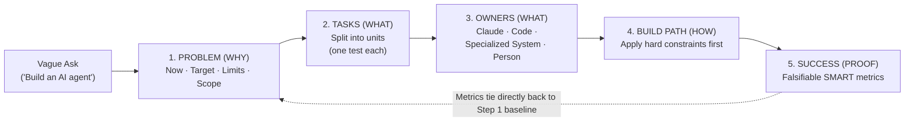

---
tags:
  - ccar-p
  - domain-1
  - solution-design
  - architecture
exam_weight: 17%
status: in-progress
---

# Domain 1: Solution Design & Architecture (17%)

> [!abstract] Domain Role in CCAR-P
> **Domain 1 (17%)** is the second-largest domain on the CCAR-P exam. It tests whether you can translate an ambiguous business request into a **defensible, minimal, testable, and business-aligned** architecture—without over-engineering with agents or ignoring hard enterprise constraints.

---

## 1. Core Architect Mindset for Domain 1

Internalize these **5 mental models** before memorizing any individual pattern:

1. **Treat every request as a *hypothesis*, not a spec.**
   - When a stakeholder says *"Build an AI agent for X"*, never accept "agent" as a requirement. Always work backward to the **business problem, current baseline, target state, hard constraints, and scope**.
2. **Start simple; escalate complexity only when earned.**
   - Follow the architecture ladder strictly: **No LLM (code/rules)** $\rightarrow$ **Single Augmented LLM** $\rightarrow$ **Structured Workflow** $\rightarrow$ **Single Autonomous Agent** $\rightarrow$ **Multi-Agent System**.
   - Every step up the ladder trades **predictability, latency, cost, and debuggability** for **flexibility**.
3. **Assign every task to its rightful owner.**
   - Never force Claude to do what **deterministic code**, a **specialized system** (SQL DB, regex, rules engine, ML classifier), or a **human** should own.
   - Claude owns **ambiguity, unstructured language, synthesis, and contextual judgment**—not exact arithmetic, access control, or irreversible approvals.
4. **Hard constraints veto soft preferences.**
   - Apply **non-negotiable constraints first** (data residency, compliance/auditability, strict latency SLAs, deterministic accuracy guarantees, budget ceilings) before choosing models, orchestration patterns, or build paths.
5. **Make every decision testable and falsifiable.**
   - A task is only well-scoped if it has **one clear test**.
   - A success criterion is only valid if it **can actually fail** and directly compares against the **baseline** established in Step 1.

---

## 2. Lesson-by-Lesson Study Guide (1.1 – 1.6)

### 1.1 From Business Problem to Claude Solution
**The 5-Decision Design Method (Execute strictly in order — each step narrows the next):**

- **Step 1 — Problem Statement (`WHY`):**
  - Must explicitly define **4 elements**: **Baseline (now)**, **Target (desired state)**, **Constraints/Limits (hard vs. soft)**, and **Scope (in-scope vs. out-of-scope)**.
- **Step 2 — Task Decomposition (`WHAT`):**
  - Break a monolithic "solution" into discrete tasks where **each task has one clear test/verification condition**.
- **Step 3 — Task Ownership Matrix (`WHAT`):**

| Owner | Best Suited For | Never Use For |
| :--- | :--- | :--- |
| **Claude** | Unstructured text, summarization, classification with nuance, drafting, multi-source synthesis, fuzzy reasoning | Exact math/calculations, auth/RBAC enforcement, strict PII redaction, deterministic state transitions |
| **Deterministic Code** | Validation (JSON/schema), calculations, routing rules, retries, rate limiting, PII masking, audit logging, guardrails | Handling messy natural language or open-ended ambiguity |
| **Specialized System** | Relational DB queries, vector/keyword search engines, ERP/CRM workflows, fraud/OCR/tabular ML models | General conversational reasoning |
| **Person (HITL)** | High-stakes irreversible actions (financial payouts, legal/medical sign-off, policy exceptions), final accountability | High-volume repetitive boilerplate triage |

- **Step 4 — Build Path (`HOW`):**
  - Filter options by **hard constraints first** (e.g., buy vs. build, API vs. Bedrock/Vertex VPC deployment, sync vs. async/Batch, prompt-only vs. RAG vs. workflow).
- **Step 5 — Success Criteria (`PROOF`):**
  - Must be **SMART** and **falsifiable** (*can actually fail*—e.g., *"Reduce average L1 ticket resolution time from 14 min baseline to ≤ 6 min while maintaining CSAT ≥ 4.5/5 and hallucination rate < 1%"*, NOT *"Improve customer support quality"*).

---

### 1.2 Designing the End-to-End Architecture
- **Think beyond the prompt:** The LLM call is only one component in a production system.
- **Key architectural layers to design:**
  - **Ingestion & Pre-processing:** Input validation, PII redaction/tokenization, auth/permission checks *before* reaching Claude.
  - **Orchestration & Execution Mode:**
    - **Synchronous / Streaming:** User waiting live with tight latency SLA (use streaming to improve Time-to-First-Token / perceived latency).
    - **Asynchronous / Queue / Batch API:** High-volume offline jobs (e.g., 50,000 docs) where cost and throughput matter more than real-time response.
  - **Resilience & Reliability:** Request queues, **exponential backoff with jitter** for HTTP 429/529, circuit breakers, semantic/response caching, and **graceful degradation / human fallback** when confidence is low or APIs fail.
  - **Post-processing & Output Boundaries:** Schema validation, deterministic fact/number verification against source DBs, safety classifiers, and audit logging.

---

### 1.3 Augmented LLM, Workflow, or Agent?
Master the **Anthropic Pattern Selection Ladder**:

| Pattern | Control Flow | Use When | Avoid When |
| :--- | :--- | :--- | :--- |
| **Augmented LLM** | Single call + retrieval, tools, or memory | One-shot Q&A, extraction, classification, single lookup | Multi-step dependencies or iterative verification needed |
| **Workflow** | **Deterministic code** orchestrates multiple LLM calls | Steps are predictable and well-defined (even if complex) | Exact sequence of steps cannot be known in advance |
| **Autonomous Agent** | **LLM dynamically decides** tools, loops, and next steps | Open-ended tasks, unpredictable paths, iterative exploration | Tasks have strict latency/cost budgets, fixed SOPs, or strict auditability requirements |

**Core Composable Workflow Patterns (Must Know):**
1. **Prompt Chaining:** Fixed sequential steps with programmatic gates/checks between steps (trades latency for higher accuracy).
2. **Routing:** Classify input first and dispatch to specialized prompts, workflows, or smaller/larger models (optimizes both accuracy and cost).
3. **Parallelization:**
   - *Sectioning:* Split independent subtasks to run concurrently (cuts latency).
   - *Voting:* Run same task multiple times / multiple perspectives for higher confidence.
4. **Orchestrator–Workers:** Central LLM dynamically breaks down a task whose subtasks aren't fixed upfront and delegates to worker LLMs, then synthesizes.
5. **Evaluator–Optimizer:** One LLM generates, another evaluates against criteria in a feedback loop (best when clear evaluation criteria exist and iteration demonstrably improves output).

> [!important] Agent Design Rule
> If you choose an **Autonomous Agent**, you **must** specify **bounded execution** (max iterations, token/cost budget, timeouts, allowed tool list, and human escalation path).

---

### 1.4 Multi-Agent Systems and Orchestration
- **When Multi-Agent is actually justified:**
  - Single agent suffers from **context window bloat / context degradation** across distinct phases.
  - **Tool overload** (too many overlapping tools confuse selection).
  - Genuine **separation of concerns / privilege boundaries** (e.g., read-only research agent vs. tightly gated execution agent; parallel independent investigations).
- **Common Topologies:**
  - **Coordinator / Subagent (Hierarchical):** Lead agent plans and delegates bounded tasks to specialized subagents; returns distilled outputs to keep coordinator context clean.
  - **Sequential Pipeline / Handoff:** Explicit state handoff between specialized stages (often better implemented as a deterministic workflow unless handoffs are dynamic).
  - **Parallel Fan-out / Fan-in:** Multiple subagents research independent sources simultaneously, followed by a synthesizer.
- **Multi-Agent Risks & Failure Modes (Exam Favorites):**
  - Compounded **latency and token cost** (each hop duplicates context).
  - **Context drift / telephone game** (critical constraints lost between agents).
  - **Infinite ping-pong loops** without max-turn/termination guards.
  - **Conflicting writes / race conditions** on shared external state.

---

### 1.5 Decomposing Complex Problems
- **Goal:** Turn one fragile, untestable monolithic prompt into **isolated, composable, testable components**.
- **How to decompose properly:**
  1. Separate **deterministic logic** (parsing, filtering, calculations, policy checks) from **probabilistic reasoning** (interpretation, drafting).
  2. Ensure every decomposed stage has a **clear input/output contract** (e.g., strict structured JSON schema) and **independent evaluation metric**.
  3. Isolate failure domains so when quality drops, you can diagnose *which* stage failed (retrieval vs. extraction vs. synthesis) instead of guessing.
- **Balance check:** Don't over-decompose into dozens of tiny sequential LLM calls if latency SLA is tight—merge adjacent steps or parallelize independent ones.

---

### 1.6 Tying Solutions to Business Value
- **Every technical choice must map to a business outcome:**
  - Translate technical metrics (token cost, TTFT, P95 latency, precision/recall) into **business KPIs** (cost per ticket, hours saved, conversion rate, compliance risk avoided, time-to-value).
- **Build vs. Buy & Phased Delivery:**
  - Validate with a **narrow-scope MVP / pilot** (e.g., human-in-the-loop shadow mode or limited user cohort) before full automation.
  - Account for **Total Cost of Ownership (TCO)**—not just API token fees, but also eval pipelines, monitoring, prompt/model maintenance, and human review overhead.
  - Know when **NOT** to build with Claude (if an existing SaaS tool or 50 lines of deterministic code solves the problem cheaper and more reliably).

---

## 3. High-Signal Exam Keywords & Decoding Table

When reading a CCAR-P Domain 1 scenario, immediately highlight these trigger phrases:

| Keyword / Phrase in Exam Stem | Architectural Signal / What It Points To |
| :--- | :--- |
| *"Stakeholder asks to build an AI agent..."* | **Vague ask / Hypothesis trap** — Start by clarifying problem statement (baseline, target, constraints, scope), NOT picking an agent framework. |
| *"Predictable / repeatable / well-defined SOP / fixed steps"* | **Workflow (Prompt Chaining / Routing)** — Do **not** pick an autonomous agent. |
| *"Open-ended / unknown number of steps / dynamic exploration"* | **Autonomous Agent** (with explicit max steps, budgets, and guardrails). |
| *"Exact / 100% deterministic / zero tolerance / regulatory / calculation / RBAC"* | **Deterministic Code or Specialized System** — Never rely on Claude or prompt instructions alone. |
| *"Irreversible action / high-stakes decision / legal or financial approval"* | **Human-in-the-Loop (HITL)** approval gate before execution. |
| *"Strict latency SLA (e.g., < 2s) / real-time interactive"* | **Avoid deep sequential chains or multi-agent loops**; use **routing**, **parallelization**, **caching**, or **streaming**. |
| *"50,000 documents / overnight / non-real-time / cost-sensitive"* | **Validate on small sample first, then Message Batch API** (async). |
| *"30+ tools / degraded tool selection / bloated context"* | **Decompose / Routing / Subagent isolation** to scope tools and context per task. |
| *"Improve user experience / make it smarter / high quality"* | **Unfalsifiable / non-SMART metric trap** — Replace with measurable criteria tied to baseline. |
| *"Accuracy must remain unchanged while cutting cost"* | **Caching / Prompt Caching / Architecture optimization** — Do **not** blindly downgrade model tier or truncate critical context. |

---

## 4. Common Domain 1 Exam Traps & Anti-Patterns

| # | Exam Trap (Distractor) | Why It Fails | Correct CCAR-P Mindset |
| :-: | :--- | :--- | :--- |
| **1** | **Agent-First Bias ("Use an autonomous multi-agent system for everything")** | Adds latency, cost, non-determinism, and debugging overhead when steps are predictable. | Always choose the **simplest pattern** (Code $\rightarrow$ Augmented LLM $\rightarrow$ Workflow $\rightarrow$ Agent $\rightarrow$ Multi-Agent) that meets measured requirements. |
| **2** | **Treating a Solution Ask as a Spec** | Jumping straight to tool/model design when stakeholders only gave a vague ask (*"build a chatbot/agent"*). | Reframe into **Baseline + Target + Hard Constraints + Scope** first. |
| **3** | **Soft-Constraint Optimization Before Hard Constraints** | Choosing the cheapest or "most advanced" option while violating data residency, compliance, latency SLA, or accuracy requirements. | **Hard constraints veto soft factors** every time. |
| **4** | **Prompting Away Deterministic Requirements** | Putting *"Never hallucinate numbers"*, *"Only show user's own records"*, or *"Always calculate tax accurately"* in the system prompt. | Enforce math, permissions, schema validation, and data verification in **code/specialized systems**. |
| **5** | **Unfalsifiable Success Criteria** | Accepting vague goals like *"stakeholders are satisfied"* or *"output looks good in playground"* with no baseline comparison. | Write **falsifiable SMART criteria** directly anchored to the Step 1 baseline. |
| **6** | **Monolithic "Mega-Prompt"** | Stuffing extraction, policy checking, calculation, and formatting into one giant prompt. | **Decompose** into testable stages (one test per task) separating deterministic vs. LLM ownership. |
| **7** | **Unbounded Autonomous Loops** | Deploying an agent without max-iteration caps, cost ceilings, or escalation paths. | Every agent loop requires **explicit stopping conditions, budgets, and human fallback**. |
| **8** | **Big-Bang Automation Without Proof** | Replacing human workflows at 100% traffic on day one. | Start with **shadow mode / HITL / representative sample validation** and tie rollout gates to business metrics. |

---

## 5. Self-Check Questions Before Moving to Domain 2

- [ ] Can I turn a vague request (*"Build an agent for customer refunds"*) into a **5-decision design** (Problem $\rightarrow$ Tasks $\rightarrow$ Owners $\rightarrow$ Build Path $\rightarrow$ Falsifiable SMART Success Criteria)?
- [ ] Given a scenario, can I justify **why a Workflow beats an Agent** (or vice versa) in terms of predictability, latency, cost, and auditability?
- [ ] Can I immediately identify which tasks belong to **Claude vs. Code vs. Specialized System vs. Person**?
- [ ] Can I spot **which constraint in a scenario is a Hard Constraint** that immediately eliminates 2–3 distractor answers?
- [ ] Can I explain the **3 main failure modes of multi-agent systems** and when single-agent + clean tools is superior?
